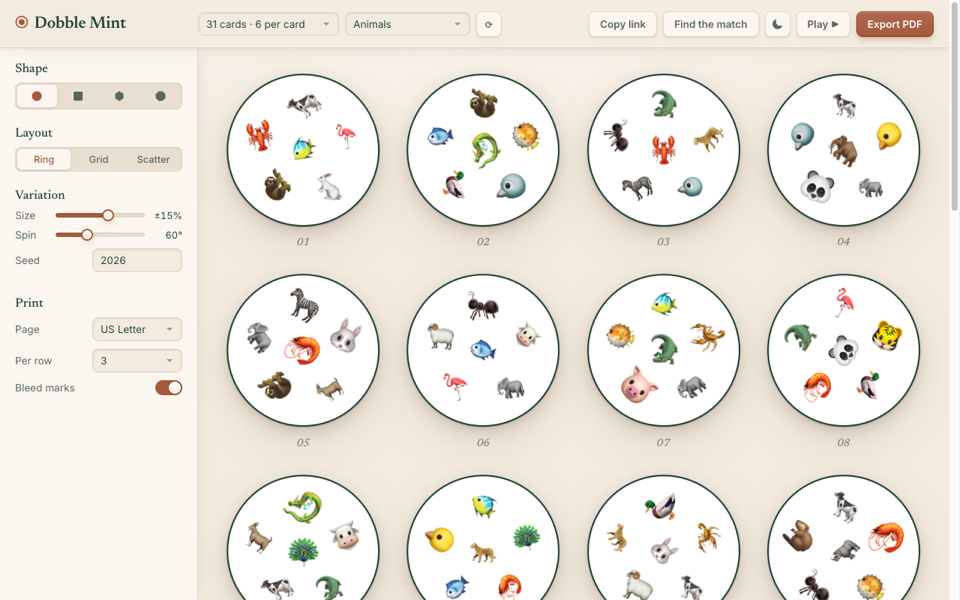
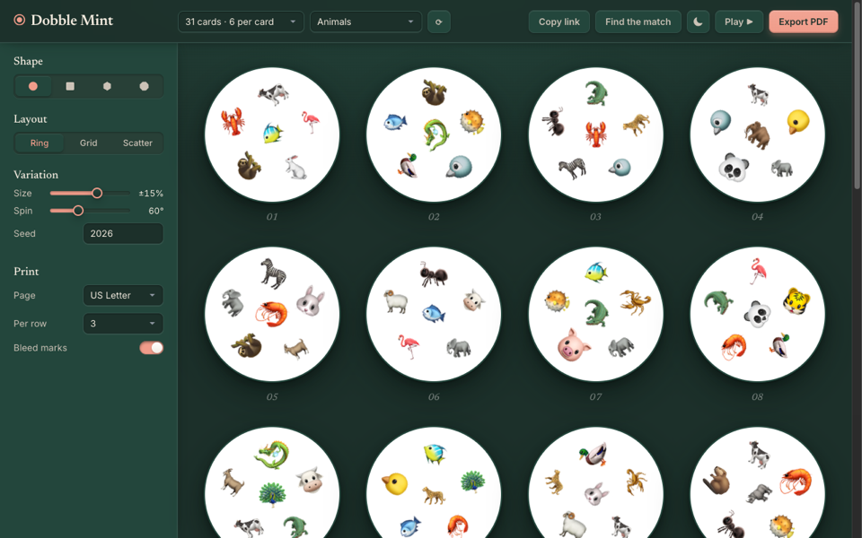
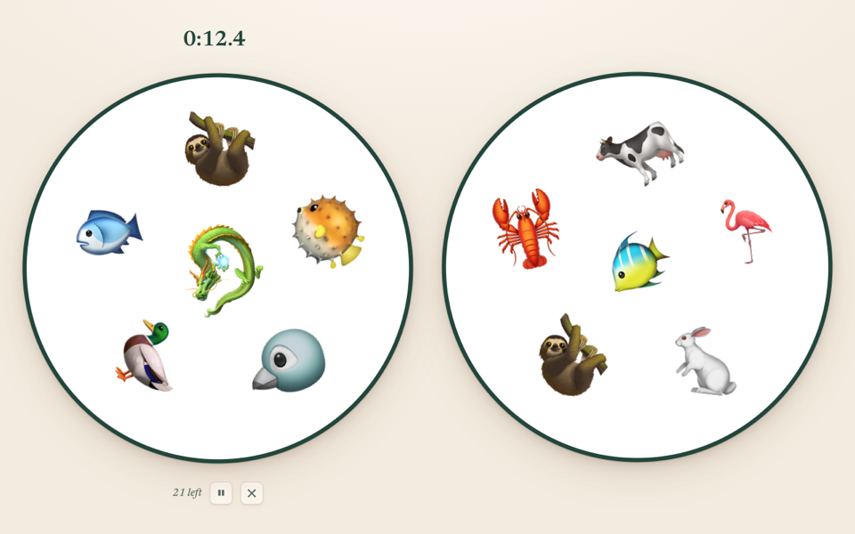
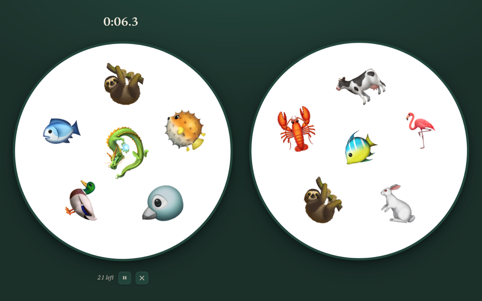

# ⊙ Dobble Mint (Spot It Card Generator)

A premium single-page application for generating custom **Spot It** (also known as **Dobble**) game cards. Built with pure mathematics and modern web technologies.

| Light | Dark |
| :---: | :---: |
|  |  |
|  |  |

## 🧬 The Mathematics

The "magic" behind Spot It is based on **Finite Projective Planes**. 
- Each **card** represents a **line** in the projective plane.
- Each **symbol** represents a **point** in the projective plane.
- By the axioms of projective geometry, **any two lines intersect at exactly one point**.
- This translates to: **Any two cards share exactly one symbol in common.**

This generator currently supports prime orders $n \in \{2, 3, 5, 7, 11\}$. 
- **Total Cards:** $n^2 + n + 1$
- **Symbols per Card:** $n + 1$
- **Total Unique Symbols:** $n^2 + n + 1$

## ✨ Features

- **Mathematical Precision:** Generates valid incidence structures for various orders.
- **Symbol Themes:** Choose from five OpenMoji sets: Animals & Nature (160 symbols), Flags (270),
  Food & Drink (131), Symbols (224), and Objects (266). All but Food & Drink can fill the largest
  deck.
- **Card Shapes:** Generate cards as Circles, Squares, Hexagons, or Octagons.
- **Layout Engines:**
  - **Ring:** Classic Spot It layout with a center symbol.
  - **Grid:** Orderly placement for clarity.
  - **Scatter:** Poisson-disk sampling for a more organic feel.
- **Deep Customization:**
  - Size variance and rotation sliders.
  - Editable seed for reproducible decks.
- **Shareable Links:** Every setting and the seed live in the URL, so a link recreates the exact deck.
- **Find the Match:** Click any two cards to highlight the symbol they share.
- **Play the Game:** "The Tower" with your deck: a solo time trial with best times, two players
  head to head on one phone or tablet laid flat, or Pass & Play for 2 to 6 players taking turns
  on the same deal. Games can be paused, and the results screen shows per-card stats.
- **Light and Dark Modes:** Follows your system setting, with a manual toggle.
- **Print-Ready PDF Export:** Each card is rasterized to a JPEG at 3x scale, so emoji print
  exactly as they look on screen. Choose A4 or US Letter, 2 to 4 cards per row, and optional bleed
  marks.

## 🚀 Getting Started

Simply open `index.html` in any modern web browser, or use the hosted version at
https://hrpatel.github.io/dobble-mint/. No server or installation required!

Run the unit tests with Node (no install needed):

```sh
node --test "tests/*.test.js"
```

### Local Development
The project is built with:
- **Core:** HTML5, CSS3, Vanilla JavaScript.
- **PDF Engine:** [jsPDF](https://github.com/parallax/jsPDF) (using high-fidelity canvas rasterization).
- **Fonts:** Inter and Newsreader (via Google Fonts).

## 🛠️ Project Structure

```text
dobble-mint/
├── index.html       # Single page: deck designer + game
├── css/
│   ├── style.css    # Tabletop design system (light + dark)
│   └── play.css     # Game layout
├── js/
│   ├── math.js      # Projective plane construction engine
│   ├── openmoji.js  # Generated OpenMoji themes and artwork (CC BY-SA 4.0)
│   ├── symbols.js   # Theme pool management
│   ├── renderer.js  # SVG card rendering logic
│   ├── deck.js      # Shared deck settings, URL format, and deck building
│   ├── pdf.js       # PDF assembly and export
│   ├── app.js       # Designer UI and state
│   ├── game.js      # Game rules (no DOM)
│   ├── stats.js     # Results-screen stats and charts
│   └── play.js      # Game view UI
├── scripts/         # build-openmoji.js regenerates js/openmoji.js
└── tests/           # Node unit tests (node --test)
```

Ideas and bugs are tracked in [GitHub issues](https://github.com/hrpatel/dobble-mint/issues).

## 📝 License

MIT License - feel free to use and modify for your own game nights!

Symbol artwork in `js/openmoji.js` is from [OpenMoji](https://openmoji.org), the open-source
emoji and icon project, licensed under
[CC BY-SA 4.0](https://creativecommons.org/licenses/by-sa/4.0/). Exported PDFs credit it on
the last page.
